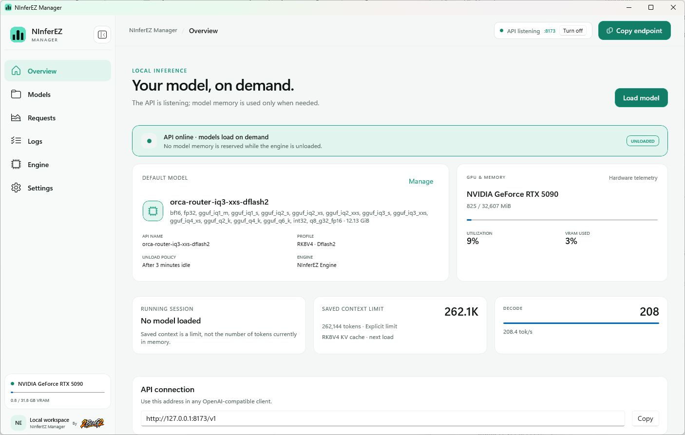

# NInferEZ Manager

A native Windows control center for [NInferEZ Engine](https://github.com/BenGamliel/NInferEZ-Engine):
simple model and API management first, useful controls and diagnostics when you need them.

[Download Installer](https://github.com/BenGamliel/NInferEZ-Manager/releases/download/v0.0.1/NInferEZ-Manager-Setup-0.0.1.exe) ·
[Download Portable](https://github.com/BenGamliel/NInferEZ-Manager/releases/download/v0.0.1/NInferEZ-Manager-Portable-0.0.1.zip) ·
[Release notes and checksums](https://github.com/BenGamliel/NInferEZ-Manager/releases/tag/v0.0.1)

Windows x64. Engine packages are selected and downloaded separately; no model weights are bundled.
This first release is available for community testing, not a claim of qualification on every GPU.



*Actual 0.0.1 desktop interface. The model is unloaded; the Decode card shows retained request
metrics, not generation performed for this screenshot. Saved context is a limit, not occupied context.*

The OpenAI-compatible API starts with the application, normally on `http://127.0.0.1:8173/v1`.
Models load on their first inference request, not just because the window is open.
The default memory policy unloads the model after three idle minutes.

Product version is **0.0.1**. Current implementation and test evidence are tracked in
[the acceptance matrix](docs/ACCEPTANCE-MATRIX.md); a successful build is not a GPU qualification.
The [publication verification record](docs/PUBLICATION-0.0.1.md) describes exactly what was checked
for these downloads and which qualification gates remain open.

## Getting started

1. Install the application, or extract the complete Portable ZIP to a writable folder. Do not run an EXE from inside the ZIP.
2. Open Manager. If no engine is available, choose the recommended hardware package on **Engine** and let verification complete. Manual package selection remains available.
3. Put a supported `.ninfer` artifact in the displayed **Models** folder, or use **Link a model** to keep it at its current location. Linking does not copy weights.
4. Select a model and review its profile. An optional API name can be entered by you; otherwise the existing model ID is used.
5. Copy the endpoint and exact model name into your OpenAI-compatible client. An arbitrary client API key is not authentication: it must match the Manager key if you configured one.

The API can list available models before loading one. The first generation includes model loading
and, on a new GPU, possible route calibration. Loading progress is not an invented percentage;
use **Cancel loading** if you want to stop. Merely opening or hiding the window is not a model load.

## Everyday controls

- **Overview:** API, selected/loaded model, runtime state and relevant next action.
- **Models:** local/linked library, optional API aliases, profiles and curated recommendations.
- **Requests:** recent engine metrics; unavailable values are not benchmark results.
- **Logs:** bounded technical history, search and the logs folder.
- **Engine:** compatible packages, verified downloads and selection.
- **Settings:** appearance, startup, memory policy, local API and maintenance. Ordinary preferences save automatically; profile and API changes have their own explicit actions.

LAN access is off by default. Enabling it exposes the listener on network interfaces, including VPN
interfaces where permitted. Configure an API key and review firewall/VPN access; Manager does not
silently modify those services. API access does not require the model to be manually preloaded.

## Packages and data

The clean Installer and Portable do not contain model weights or personal settings. A separate
ready-to-test Portable can include a verified engine; its local links/settings are private test data,
not a public release. Models are kept separately and are not replicated into every application build.

Portable data lives beside the application. Installed mutable data lives under the documented
per-user data root; legacy model paths can remain linked rather than being copied. External model
links do not give uninstall permission to delete the external files. Uninstall keeps managed data
unless you explicitly choose removal.

Keep the complete package layout together. Moving a Portable preserves its relative local layout,
but an external model link still needs its target to exist. Back up profiles/settings before manually
rearranging data directories.

## Compatibility and evidence

Engine targets are architecture-specific: `sm86`, `sm89` and `sm120a`. Blackwell compute capability
12.0 maps to the `sm120a` package; a matching architecture does not establish that every model or
every card was tested. Untested combinations remain Community Preview. Native NVFP4 support is
not implied for the older targets.

Actual format/components, engine capabilities, driver and memory budget all matter. Auto context
is an estimate, not a promise that a 512K prompt fits or loads instantly. Exact/custom profiles must
not silently change quantization or KV quality. A throughput improvement requires an actual GPU
comparison with the same binary, artifact and effective profile.

## Build and test

```powershell
dotnet build NInferEZ.Manager.slnx -c Release
dotnet run --project tests\NInferManager.Backend.Tests\NInferManager.Backend.Tests.csproj -c Release
.\scripts\product-check.ps1
```

Run all three host-only regression suites and the static product checks with:

```powershell
.\scripts\verify-host.ps1
```

These are host-only checks; they do not load real model weights or allocate inference GPU memory.
The active completion plan is [PRODUCT-PLAN.md](docs/PRODUCT-PLAN.md). Historical plans and the
code-review report remain references, not fresh verification evidence.

## Package

Use the pinned SDK/runtime toolchain and an extracted, verified engine directory containing
`ninfer-serve.exe` and `engine-manifest.json`:

```powershell
.\scripts\build.ps1 -BuildId dev-001 -EngineSource '.\verified-engine'
.\scripts\product-check.ps1 -PackagePath '.\artifacts\0.0.1\dev-001\packages\Portable\NInferEZ Manager'
.\scripts\product-check.ps1 -PackagePath '.\artifacts\0.0.1\dev-001\packages\Test Portable\NInferEZ Manager' -LocalTest
```

Build IDs are provenance metadata; user-facing product version remains `0.0.1`. Inspect package
audit, hashes and build metadata before sharing. Never upload the local test copy or diagnostics
without reviewing their contents. No model weights belong in this source repository.

## Credits

NInferEZ Manager and NInferEZ Engine are separate products. Engine derives from the upstream
NInfer/ninfer-all work; its own repository includes provenance and license notices. Manager's
[third-party notices](docs/THIRD-PARTY-NOTICES.md) accompany its packages. The publisher mark is
secondary to the NInferEZ application icon.

<p><small>By</small><br></p>
