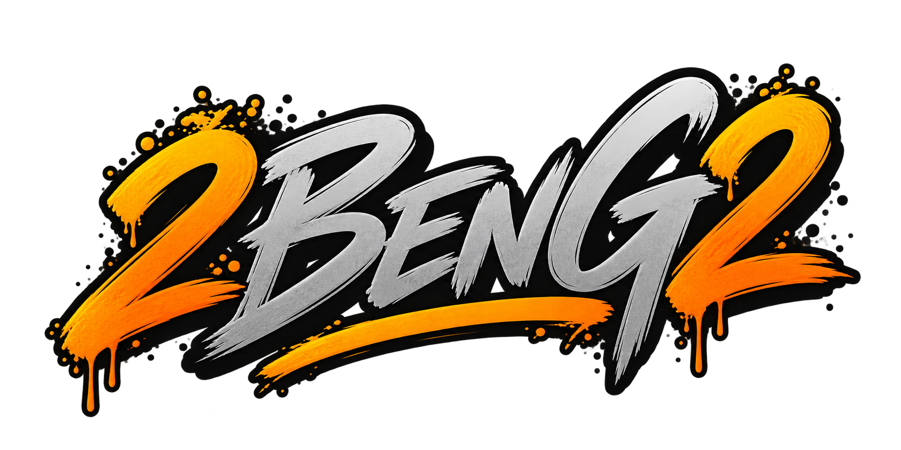

# NInferEZ Manager

Run local NInfer models on Windows from a desktop application. Manage models, GPU engines, inference profiles, API access, logs and conversions in one place.

[Download 1.0.0](https://github.com/BenGamliel/NInferEZ-Manager/releases/tag/v1.0.0) · [User guide](docs/USER-GUIDE.md) · [Models](docs/MODELS.md) · [Report an issue](https://github.com/BenGamliel/NInferEZ-Manager/issues)


## Download

| Package | Use |
|---|---|
| [Windows installer](https://github.com/BenGamliel/NInferEZ-Manager/releases/download/v1.0.0/NInferEZ-Manager-Setup-1.0.0.exe) | Install the application and shortcuts for your Windows account |
| [Portable ZIP](https://github.com/BenGamliel/NInferEZ-Manager/releases/download/v1.0.0/NInferEZ-Manager-Portable-1.0.0.zip) | Extract the complete archive into a writable folder and run `NInferEZ Manager.exe` |
| [SHA256 checksums](https://github.com/BenGamliel/NInferEZ-Manager/releases/download/v1.0.0/SHA256SUMS.txt) | Verify downloaded packages |

Windows x64. The application and CPU conversion runtime are included; engine packages and model weights are downloaded separately. Public packages contain no personal settings or model weights. Releases are currently unsigned, so Windows may display a publisher warning.

## Component terms

Manager source remains MIT. The bundled Microsoft Windows App SDK retains its
[complete component terms](docs/COMPONENT-TERMS.txt) and
[original supplier notices](docs/licenses/WindowsAppSDK-2.5.1-NOTICE.txt).
By downloading, using or redistributing the Microsoft code in either package,
you agree to those component terms; if you do not agree, do not use that code.
The installer presents the same agreement. Other open-source components retain
their own license rights. Model license copies are included under
`Docs/model-licenses` and on the [license page](https://ninferez.pages.dev/licenses/#models).

## Getting started

1. Install Manager or extract the Portable ZIP. Do not run an executable inside an archive.
2. On **Engine**, download the package recommended for your GPU. Integrity is checked before activation.
3. On **Models**, download a recommendation, put a supported `.ninfer` file in the Models folder, or link an existing file without copying it.
4. Keep managed settings enabled for ordinary use. You may optionally choose an API name for each model.
5. Connect an OpenAI-compatible client to `http://127.0.0.1:8173/v1`, using the exact model name shown in Manager.

The API starts with the application. Models load when needed for inference, not simply because the window is open. The default memory policy unloads a model after **three idle minutes**. Listing models does not load their weights. Requests can select library models by API name; one model occupies the inference GPU at a time.

## Features

- Local/linked model library, editable API aliases, profiles, recommendations and variant selection.
- Managed settings that adapt dependent controls to the model and engine; advanced manual controls remain available with understandable errors.
- Fits, Close and Not recommended VRAM estimates, including a practical context allowance rather than file size alone.
- Automatic API listening, lazy model loading, adjustable idle unload, loading cancellation and opt-in LAN access.
- GPU-specific engine downloads, SHA256 verification, activation and update checks.
- Guided/manual conversion using the same backend as the standalone Converter.
- Request metrics, searchable logs, logs-folder access, tray operation and single-instance activation.

## GPU compatibility

| GPU family | Package | Native NVFP4 weights | Qualification |
|---|---|---|---|
| Compatible RTX 3000 / Ampere, compute capability 8.6 | `sm86` | No | Community Preview |
| Compatible RTX 4000 / Ada, compute capability 8.9 | `sm89` | No | Community Preview |
| Compatible RTX 5000 / Blackwell, compute capability 12.0 | `sm120a` | Yes | RTX 5090 measurements available; other cards are Community Preview |

A matching CUDA target does not establish that every card/model combination was tested. A compatible NVIDIA driver and enough available VRAM are required. Artifact architecture, encoded tensors and optional components also matter. A valid v3 container alone is not universal model support.

## Models and measurements

[Available models](docs/MODELS.md) include OrcaRouter IQ3_XXS, Swift NVFP4 and Heretic IQ2_XS. Their cards contain artifact-specific features, licenses and available benchmarks. Configured context capacity is not actual prompt length, and peak decode speed is not an average or loading time.

Compatible catalog additions can arrive without an application update. New architectures or capabilities may need a new engine/application version.

## Network and data

The API is local-only by default. LAN access is optional; configure an API key and review firewall/VPN access before enabling it. Manager does not silently change those services.

Portable data lives beside the application; installed data uses the per-user location described in the [guide](docs/USER-GUIDE.md). External model links require their targets to remain available. Uninstalling does not delete linked files outside managed application folders.

## Ecosystem

[NInferEZ Engine](https://github.com/BenGamliel/NInferEZ-Engine) provides standalone serving and inspection. [NInferEZ Converter](https://github.com/BenGamliel/NInferEZ-Converter) provides independent conversion. [Models on Hugging Face](https://huggingface.co/2beng2) are downloaded separately. See the [ecosystem guide](docs/ECOSYSTEM.md).

## Development and licensing

```powershell
dotnet build NInferEZ.Manager.slnx -c Release
dotnet run --project tests/NInferManager.Backend.Tests -c Release
dotnet run --project tests/NInferManager.Control.Tests -c Release
dotnet run --project tests/NInferManager.Update.Tests -c Release
```

These are host-only checks, not GPU qualification. See [architecture](docs/ARCHITECTURE.md) and [acceptance coverage](docs/ACCEPTANCE-MATRIX.md).

Manager uses the [MIT license](LICENSE). Bundled components retain their [third-party notices](docs/THIRD-PARTY-NOTICES.md); model licenses are independent. The Engine derives from NInfer/ninfer-all, whose upstream authorship and changes are documented in its repository. NInferEZ is an independent distribution.

<p><small>By</small><br></p>
